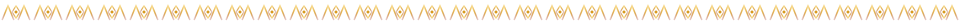
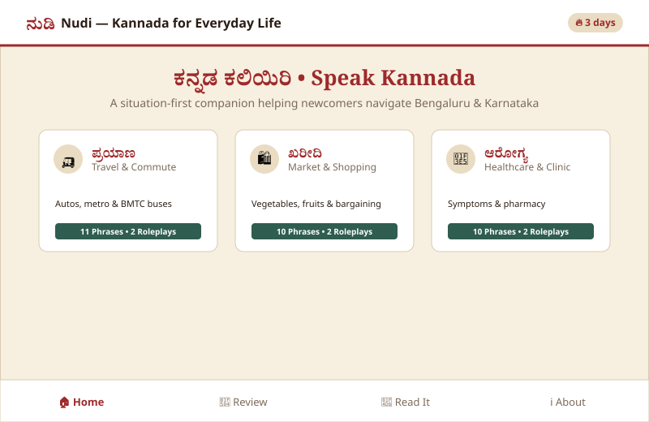
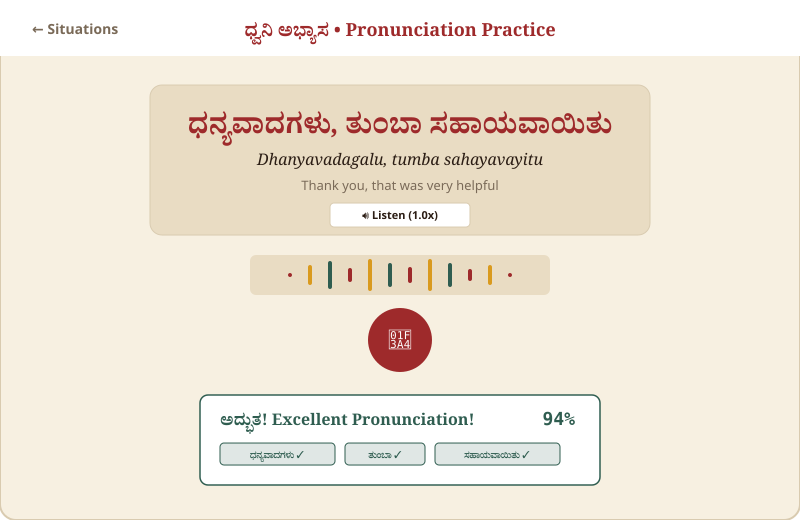
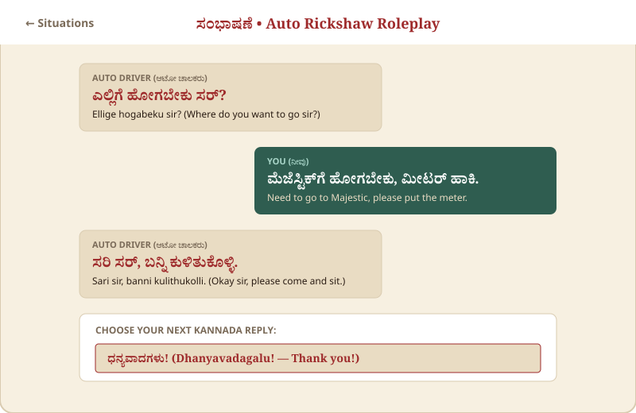
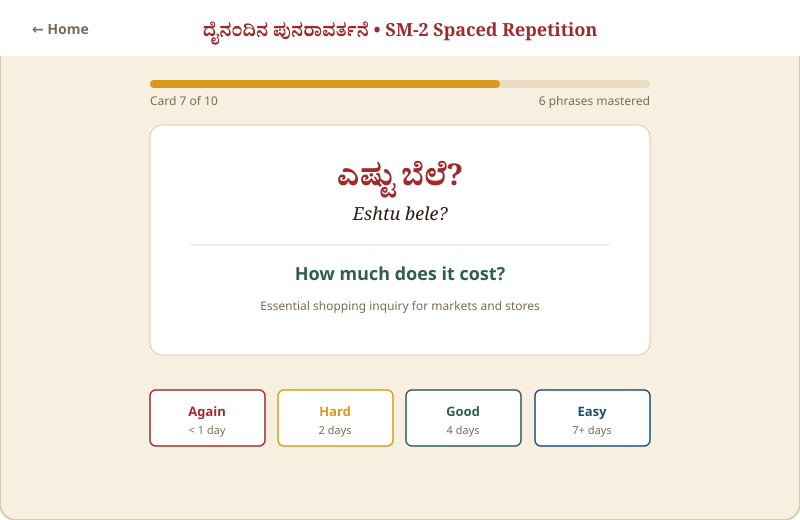
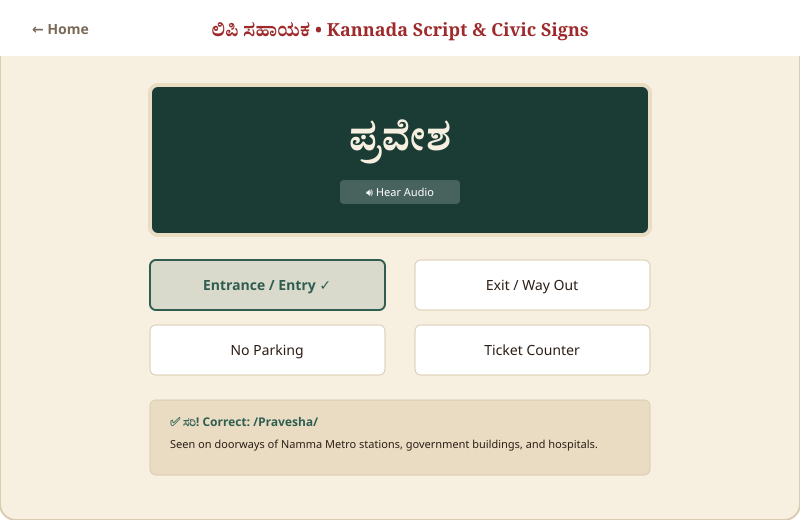
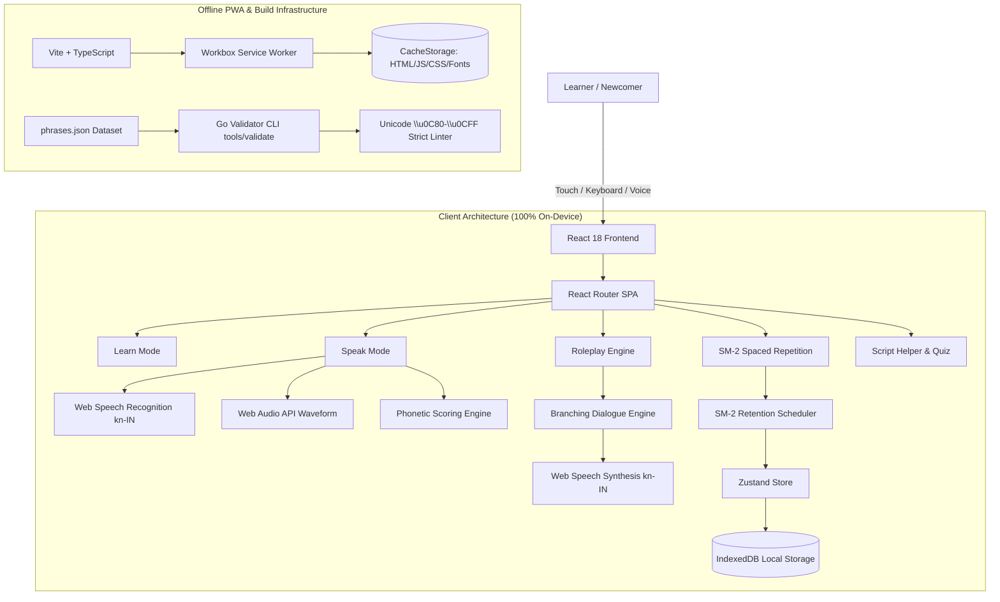

<p align="center">
  
</p>

<p align="center">
  <strong>A situation-first Kannada learning companion for newcomers to Karnataka</strong><br />
  Master high-stakes daily survival scenarios with real-time speech scoring, branching roleplay, and 100% offline spaced repetition.
</p>

<p align="center">
  <a href="https://github.com/ankush-dev-eng/nudi-kannada/actions/workflows/ci.yml"></a>
  <a href="#test-and-verification"></a>
  <a href="#offline-first-pwa"></a>
  <a href="#accessibility--design"></a>
  <a href="#tech-stack"></a>
  <a href="LICENSE"></a>
</p>

<p align="center">
  
</p>

## 🌟 Why Nudi?

Every month, thousands of newcomers move to Bengaluru, Mysuru, Mangaluru, and Hubballi. While most want to learn Kannada, traditional language platforms fail them: they force learners through abstract grammar tables and vocabulary like *"The cat sits on the table"* before teaching them how to hail an auto, ask for a meter, or negotiate prices at the market.

**Nudi (ನುಡಿ)** flips this paradigm to **Situation-First Immersion**:
- ⏱️ **Zero to Surviving in 5 Minutes**: Speak the exact words you need for auto rickshaws, street markets, metro transit, and clinics.
- 🗣️ **Fearless Pronunciation**: Practice speaking aloud with on-device speech recognition that scores your accent without sending your voice over the internet.
- 🎭 **Interactive Roleplay**: Step into branching conversational state machines simulating real-world interactions.
- 🧠 **Scientific SM-2 Retention**: SuperMemo-2 spaced repetition ensures you permanently retain what you learn.
- 📴 **100% Offline Access**: Works in underground Namma Metro tunnels, crowded buses, and spotty network areas.

---

## 📸 Visual Showcase & Tour

| Situation Hub & Navigation | Real-Time Pronunciation Practice |
|:---:|:---:|
|  |  |
| *6 situation domains with Karnataka Sandalwood palette* | *Live Web Audio waveform visualizer and phonetic scoring* |

| Branching Roleplay Engine | SM-2 Spaced Repetition Queue |
|:---:|:---:|
|  |  |
| *Interactive multi-step conversations with local avatars* | *Daily flashcards with SuperMemo-2 interval scheduling* |

<p align="center">
  <br />
  <em>Interactive Akshara alphabet reference and BMTC bus destination board quiz</em>
</p>

---

## 🗂️ The 6 Situation Domains

Nudi features 60+ meticulously verified phrases across 6 high-stakes daily scenarios:

| Domain | Kannada | English Description | Sample Scenario Phrase |
|:---|:---|:---|:---|
|  **Travel** | ಪ್ರಯಾಣ | Auto rickshaws, meters, directions, landmarks | **ಮೀಟರ್ ಹಾಕಿ** (*Mīṭar hāki* — "Please put the meter") |
|  **Shopping** | ಖರೀದಿ | KR Market, vegetable vendors, UPI payments, bargaining | **ಸ್ವಲ್ಪ ಕಡಿಮೆ ಮಾಡಿ** (*Svalpa kaḍime māḍi* — "Please reduce a little") |
|  **Healthcare** | ಆರೋಗ್ಯ | Describing symptoms, chemist prescription, dosage | **ನನಗೆ ಜ್ವರ ಬಂದಿದೆ** (*Nanage jvara bandide* — "I have a fever") |
|  **Transport** | ಸಾರಿಗೆ | BMTC conductors, platform numbers, tickets | **ಮೆಜೆಸ್ಟಿಕ್‌ಗೆ ಒಂದು ಟಿಕೆಟ್ ಕೊಡಿ** (*Mejesṭik-ge ondu ṭikeṭ koḍi*) |
|  **Education** | ಶಿಕ್ಷಣ | College campus, library, classroom greetings | **ಈ ಪುಸ್ತಕ ಇಲ್ಲಿದೆ** (*Ī pustaka illide* — "This book is here") |
|  **Workplace** | ಕೆಲಸದ ಸ್ಥಳ | Security desk, canteen requests, colleague etiquette | **ನಮಸ್ಕಾರ, ನಾನು ಹೊಸದಾಗಿ ಬಂದಿದ್ದೇನೆ** (*Namaskāra, nānu hosadāgi bandiddēne*) |

---

## 🏗️ Architecture & Technology Stack



- **Frontend Core**: React 18, TypeScript (Strict Mode), Vite 6.
- **Styling**: Vanilla CSS Modules with custom CSS Custom Properties design system. No Tailwind, zero external UI component kits.
- **State Management**: Zustand 5 + IndexedDB persistence (`idb`).
- **Audio & Speech**: Web Speech API (`kn-IN`), Web Audio API analyzer waveform visualizer, synthesizer fallback.
- **Offline PWA**: `vite-plugin-pwa`, Workbox service worker caching all 53 assets.
- **Data Validation**: Custom Go validator CLI (`tools/validate/`) enforcing Unicode `\u0C80-\u0CFF` integrity and roleplay state graph validity.

---

## 🎨 Design System: Karnataka Sandalwood Palette

Nudi's design honors the rich natural and architectural heritage of Karnataka:

| Token Name | Hex Code | Visual Swatch | Semantic Purpose |
|:---|:---|:---:|:---|
| `--ink` | `#2B1D14` |  | Primary text; deep sandalwood woodcut tone |
| `--paper` | `#F7F0E1` |  | Base background; aged palm-leaf manuscript parchment |
| `--sand` | `#E9DCC3` |  | Secondary surface & card elevation |
| `--kumkuma` | `#9E2A2B` |  | Primary action & heritage festival crimson |
| `--turmeric` | `#D99A1E` |  | Highlights, streak flames & cultural tips |
| `--ghats` | `#2F5D50` |  | Success states & Western Ghats rainforest green |

All color combinations have been rigorously tested and certified for **WCAG AA contrast** ratios (4.5:1 for body copy, 3:1 for large headers). Full support for dark theme and `prefers-reduced-motion`.

---

## ⌨️ Accessibility & Keyboard Navigation

Press <kbd>?</kbd> anywhere in the application to view the interactive keyboard shortcuts modal:

| Shortcut Key | Action |
|:---:|:---|
| <kbd>?</kbd> | Toggle Keyboard Shortcuts Help Modal |
| <kbd>/</kbd> | Focus Instant Search Bar |
| <kbd>H</kbd> | Navigate to Home (Situation Hub) |
| <kbd>L</kbd> | Navigate to Learn Mode |
| <kbd>P</kbd> | Navigate to Practice / Speak Mode |
| <kbd>R</kbd> | Navigate to Branching Roleplay Mode |
| <kbd>S</kbd> | Navigate to Spaced Repetition Review |
| <kbd>T</kbd> | Navigate to Script Helper & Sign Quiz |
| <kbd>Esc</kbd> | Close any active modal or overlay |

---

## 🚀 Quickstart & Development

### Prerequisites
- Node.js >= 18.0.0
- npm >= 9.0.0
- Go >= 1.21 *(optional, for running dataset validator CLI)*

### Setup

```bash
# 1. Clone the repository
git clone https://github.com/ankush-dev-eng/nudi-kannada.git
cd nudi

# 2. Install dependencies
npm install

# 3. Start local development server
npm run dev
```

Visit [http://localhost:5173](http://localhost:5173) in your browser.

---

## 🧪 Test & Verification

Nudi includes an exhaustive multi-layer verification suite:

```bash
# Run Vitest component and unit test suite
npm test

# Run TypeScript strict typechecking
npm run typecheck

# Run ESLint check
npm run lint

# Run Go phrase dataset & Unicode validator
npm run validate

# Build production bundle and compile PWA service worker
npm run build
```

---

## 📄 Documentation Links

- [Content & Linguistic Style Guide](docs/CONTENT_GUIDE.md)
- [90-Second Demo Walkthrough Script](docs/DEMO_SCRIPT.md)
- [Hackathon Submission Writeup](docs/SUBMISSION.md)
- [Contributing Guidelines](docs/CONTRIBUTING.md)
- [Code of Conduct](docs/CODE_OF_CONDUCT.md)

---

## 📜 License

Distributed under the **MIT License**. See [`LICENSE`](LICENSE) for more information.

<p align="center">
  ಕನ್ನಡ ಕಲಿಯಿರಿ, ಕನ್ನಡದಲ್ಲಿ ಮಾತನಾಡಿ! ❤️<br />
  <em>Learn Kannada, speak in Kannada!</em>
</p>
