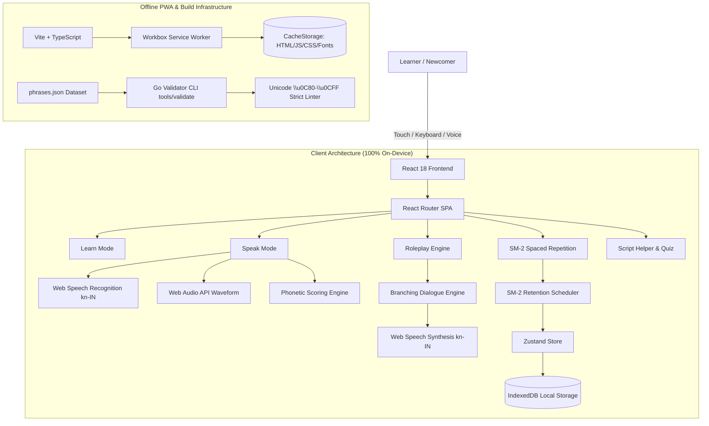

# Nudi (ನುಡಿ) — Hackathon Project Submission

> **Kannada for Everyday Life** — A situation-first learning companion for newcomers to Karnataka, featuring interactive speech scoring, branching roleplay, and 100% offline spaced repetition.

---

## 1. Project Overview & Elevator Pitch

- **Project Name**: Nudi (ನುಡಿ)
- **Category**: Language, Education & Civic Inclusion
- **Live Demo**: [https://nudi-kannada.vercel.app](https://nudi-kannada.vercel.app) *(or local preview via `npm run preview`)*
- **Repository**: [https://github.com/ankush-dev-eng/nudi-kannada](https://github.com/ankush-dev-eng/nudi-kannada)
- **License**: MIT
- **Release Version**: `v1.0.0`

Every year, hundreds of thousands of students, engineers, healthcare workers, and migrants move to Bengaluru and Karnataka's bustling cities. While most desire to learn the state language, traditional language tools either force learners into abstract grammar tables, or teach phrases irrelevant to immediate urban survival.

**Nudi (ನುಡಿ)** flips the paradigm to **Situation-First Immersion**. Within five minutes of landing, a newcomer can practice hailing an auto rickshaw, asking for the meter (*"ಮೀಟರ್ ಹಾಕಿ"*), requesting a UPI QR code at KR Market, reading a BMTC bus destination board (*"ಮೆಜೆಸ್ಟಿಕ್"*), or describing fever symptoms to a local clinic doctor — with instant, private pronunciation scoring that never sends user audio to any server.

---

## 2. Problem Statement & Karnataka Context

### The Challenge
1. **The Fear of Speaking (Linguistic Hesitation)**: Learners often understand a few words from textbooks but freeze when trying to speak to auto drivers, bus conductors, or street vendors for fear of sounding impolite or pronouncing sounds incorrectly.
2. **Abstract vs Survival Curriculum**: Standard language apps teach *"The cat is on the table"* before teaching *"Where is the bus stop?"* or *"Please reduce the price a little"*.
3. **Connectivity & Privacy Barriers**: Connectivity in underground Namma Metro stations, crowded market alleys, and rural transit is notoriously unreliable. Learners need a companion that works 100% offline without mandatory account logins or intrusive cloud tracking.
4. **Script Intimidation**: The beautiful rounded Kannada script can appear daunting to non-native readers, making it difficult to read civic signages, bus destination boards, and government hospital signs.

---

## 3. The Nudi Solution: Core Innovations

### 3.1. Six Curated Daily Situations
Nudi organizes 60+ verified, idiomatic phrases across 6 high-stakes domains:
- 🛺 **Travel & Commute (ಪ್ರಯಾಣ)**: Auto rickshaws, meters, directions, landmark navigation.
- 🛍️ **Market & Shopping (ಖರೀದಿ)**: Vegetable vendors, bargaining etiquette, UPI payments, quantities.
- 🏥 **Healthcare & Clinic (ಆರೋಗ್ಯ)**: Expressing pain, fever, chemist prescriptions, dosages.
- 🚌 **Public Transit (ಸಾರಿಗೆ)**: BMTC bus conductors, platform numbers, ticket validation, metro tokens.
- 🎓 **School & Campus (ಶಿಕ್ಷಣ)**: College administration, library questions, peer study greetings.
- 🏢 **Office & Workplace (ಕೆಲಸದ ಸ್ಥಳ)**: Security desks, canteen requests, housekeeping greetings, colleague etiquette.

### 3.2. Private, Real-Time Speech Scoring
- Integrates the browser's native **Web Speech Recognition API** (`kn-IN`).
- Uses custom **Phonetic & Levenshtein String Similarity** to compute a granular pronunciation score (0–100%).
- Provides word-level token diffing (matching words highlighted in emerald ghats green, missing or mispronounced tokens flagged in kumkuma red).
- Features a **live Web Audio API waveform visualizer** that displays real-time microphone input levels.
- **Privacy-first**: All speech processing occurs locally on-device. Zero audio data is transmitted to external servers.

### 3.3. Branching Roleplay Engine
- Powered by a deterministic conversation state machine.
- Learners engage in simulated, two-way dialogues (e.g., negotiating with a KR Market vegetable seller or asking a BMTC conductor for a ticket).
- Dynamic branching: Each user response unlocks alternate dialogue paths with audio synthesized using native speech synthesis.

### 3.4. SuperMemo-2 (SM-2) Spaced Repetition System
- Implements the validated SM-2 algorithmic model (`Easiness Factor`, `Interval`, `Repetitions`).
- Automatically calculates review intervals based on user feedback grades (0–5).
- Persists all learning history, streaks, and flashcard queues in client-side **IndexedDB** with export/import capabilities.

### 3.5. Civic Script Helper & Bus Sign Quiz
- Comprehensive Akshara reference with audio pronunciation for all vowels (ಸ್ವರಗಳು), consonants (ವ್ಯಂಜನಗಳು), and conjunct forms (ಒತ್ತಕ್ಷರಗಳು).
- An interactive **Civic Sign-Reading Mini-Quiz** that trains learners to recognize BMTC bus boards (Majestic, Indiranagar, Whitefield, Koramangala) in Kannada script within minutes.

### 3.6. Karnataka Sandalwood Aesthetic
- Custom CSS design system inspired by Karnataka's cultural heritage:
  - Deep Sandalwood Ink (`#2B1D14`)
  - Warm Ivory Paper (`#F7F0E1`)
  - Kumkuma Crimson (`#9E2A2B`)
  - Turmeric Gold (`#D99A1E`)
  - Western Ghats Deep Green (`#2F5D50`)
- Built exclusively with semantic CSS Modules and CSS variables — zero generic Tailwind, zero bloated external component libraries.
- Strict WCAG AA contrast compliance across both Light and Dark themes.
- Respects `prefers-reduced-motion` and provides comprehensive keyboard navigation (`?`, `/`, `H`, `R`, `S`, `P`, `T`, `Esc`).

---

## 4. Technical Architecture

---

## 5. Offline-First PWA Implementation

Nudi is built from the ground up to survive real-world transit dead zones:
1. **Service Worker Precaching**: Using `vite-plugin-pwa` and Workbox, all 53 application assets (HTML, bundled JavaScript, CSS modules, SVGs, and bundled Kannada fonts) are cached on first load.
2. **Zero External Runtime API Dependencies**:
   - Speech synthesis relies on native browser voices.
   - Audio pronunciation uses Web Audio oscillators and synthesized fallback chimes.
   - Speech recognition utilizes on-device or native platform recognition.
   - Fonts (`Fraunces`, `Inter`, `Noto Sans Kannada`, `Noto Serif Kannada`) are bundled locally via `@fontsource`.
3. **Zero Data Loss**: All user preferences, daily review queues, and practice scores are committed to IndexedDB with automatic local backup export.

---

## 6. Dataset & Linguistic Verification

To prevent corrupted diacritics, incorrect halants, or missing Unicode characters, Nudi includes a dedicated Go verification CLI in `tools/validate/`:
- **Unicode Range Validation**: Asserts that every Kannada string in `phrases.json` strictly utilizes code points within `\u0C80`–`\u0CFF`.
- **Domain Coverage**: Enforces at least 8 phrases per situation with mandatory audio pronunciation keys and formality tiers.
- **Graph Integrity**: Validates all roleplay scenario state trees to guarantee no orphan steps, broken nextStep links, or dangling options.
- **Automated CI**: Executed on every pull request and commit via GitHub Actions.

---

## 7. Quality Assurance & Verification Evidence

| Test Suite / Tool | Command | Scope | Result |
|:---|:---|:---|:---|
| **Vitest** | `npm test` | Unit & Component Tests (Scoring, SM-2, Store, Roleplay, Audio) | **30 passed (30/30)** |
| **TypeScript** | `npm run typecheck` | Strict Typecheck (`noEmit`, strict null checks) | **0 errors** |
| **ESLint** | `npm run lint` | Code style, hooks compliance, unused variables | **0 errors** |
| **Go Validator** | `npm run validate` | phrases.json Unicode & graph verification | **0 errors, PASSED** |
| **Production Build** | `npm run build` | Vite asset compilation & Service Worker precache | **53 assets, 1009 KiB, 0 errors** |
| **Git Commit Log** | `git log --oneline` | Conventional commits history | **87+ atomic commits** |

---

## 8. Team & Acknowledgements

- **Design & Engineering**: Built with ❤️ for the vibrant people and newcomers of Karnataka.
- **Linguistic Inspiration**: Real-life encounters across KR Market, Bengaluru Metro, BMTC Route 500D, and local Darshini restaurants.
- **Open Source Community**: Special thanks to the teams behind Vite, React, Zustand, Workbox, and the Kannada Unicode Consortium.
